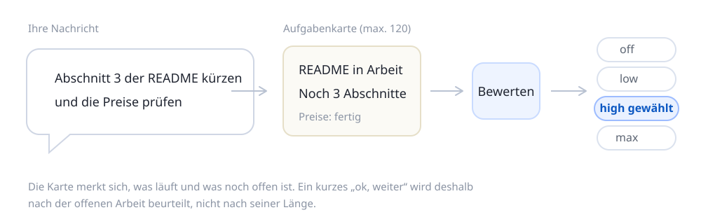
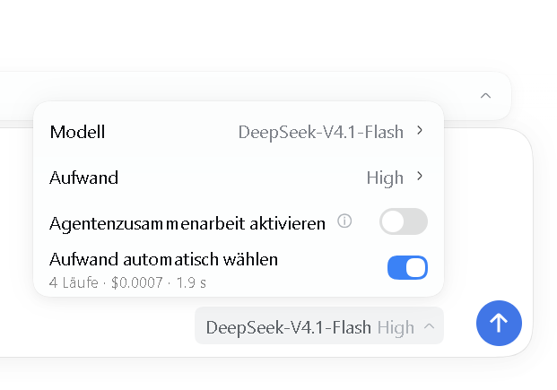

## Drei Zahlen

- Etwa **`$0.0002`** zusätzlich pro Nachricht außerhalb der Stoßzeiten, etwa **`$0.0004`** zu Stoßzeiten.
- Etwa **0,7 s** zusätzliche Wartezeit pro Nachricht.
- Nichts zu tun: Es beginnt zu arbeiten, sobald es installiert ist.

## Ein- und Ausschalten

- Standardmäßig an.
- Das manuelle Wählen eines Aufwands schaltet es **für diese Unterhaltung** aus.
- Das Ausschalten des Plugins auf der Plugin-Seite stoppt es **in jeder Unterhaltung**.

## Wofür die vier Aufwände gedacht sind

| Aufwand | Wofür |
|---|---|
| `off` | Chat, Bestätigungen, Nachschlagen, Konfiguration bearbeiten, Befehle ausführen |
| `low` | kleine Änderungen, Umbenennungen, Aufräumen, ein bekanntes Muster anwenden |
| `high` | Analyse, Fehlersuche, Erklären von Ursachen, nicht trivialer Code |
| `max` | Architektur, Abwägen von Optionen, Mehrfaktor-Abwägungen, schwierige Fehler |

## Was es nicht tut

- Es ändert Ihre Einstellungen nicht und schreibt Ihre Konfiguration nicht um.
- Es ignoriert Subagenten.

## Wann es stoppt

Wenn die Beurteilung dreimal hintereinander fehlschlägt oder ein Durchlauf auf einen API-Fehler stößt, pausiert das Plugin diese Unterhaltung, und eine Leiste über dem Eingabefeld nennt den Grund. Drücken Sie **Turn it back on** in der Leiste, oder schalten Sie den Schalter aus und wieder ein.
