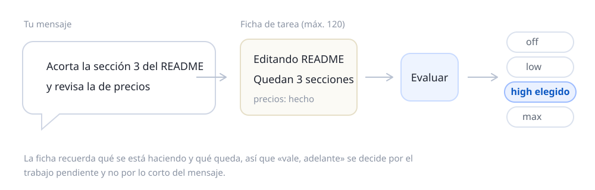
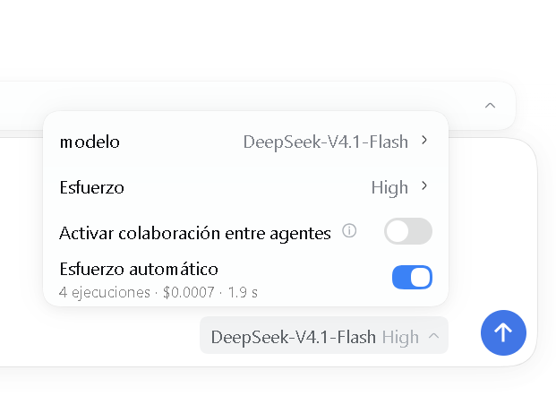

## Tres cifras

- Unos **`$0.0002`** extra por mensaje en horas valle y unos **`$0.0004`** en horas punta.
- Unos **0,7 s** de espera adicional por mensaje.
- Nada que hacer: empieza a funcionar en el momento de instalarlo.

## Activarlo y desactivarlo

- Activado de forma predeterminada.
- Elegir cualquier esfuerzo a mano lo desactiva **en esta conversación**.
- Desactivar el complemento en su página lo detiene **en todas las conversaciones**.

## Para qué sirve cada uno de los cuatro esfuerzos

| Esfuerzo | Para qué sirve |
|---|---|
| `off` | charla, confirmaciones, consultas, edición de configuración, ejecución de comandos |
| `low` | ediciones pequeñas, renombrados, orden y limpieza, aplicar un patrón conocido |
| `high` | análisis, depuración, explicar el porqué, código no trivial |
| `max` | arquitectura, comparación de opciones, decisiones con varios factores, errores difíciles |

## Lo que no hace

- No cambia tus ajustes ni reescribe tu configuración.
- Ignora los subagentes.

## Cuándo se detiene

Si la evaluación falla tres veces seguidas o un turno sufre un error de API, el complemento pausa esa conversación y una barra sobre el cuadro de entrada te explica por qué. Pulsa **Volver a activarlo** en la barra o desactiva y vuelve a activar el interruptor.
