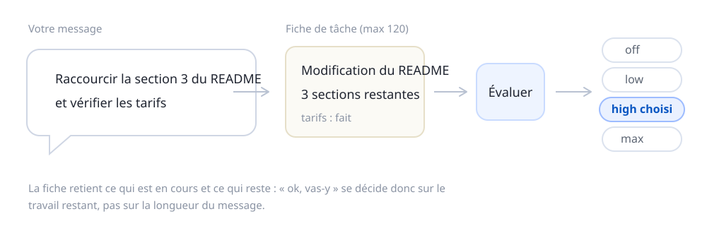
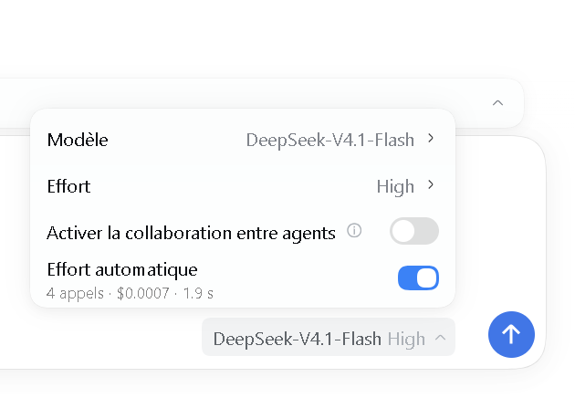

## Trois chiffres

- Environ **`$0.0002`** de plus par message aux heures creuses, environ **`$0.0004`** aux heures de pointe.
- Environ **0,7 s** d'attente supplémentaire par message.
- Rien à faire : il fonctionne dès l'installation.

## L'activer et le désactiver

- Activé par défaut.
- Choisir un effort à la main le désactive **pour cette conversation**.
- Désactiver le plugin sur la page des plugins l'arrête **dans toutes les conversations**.

## À quoi servent les quatre efforts

| Effort | À quoi il sert |
|---|---|
| `off` | discussion, confirmations, recherches, modifications de configuration, exécution de commandes |
| `low` | petites modifications, renommages, rangement, application d'un schéma connu |
| `high` | analyse, débogage, explication de cause, code non trivial |
| `max` | architecture, comparaison d'options, arbitrages multi-critères, bugs difficiles |

## Ce qu'il ne fait pas

- Il ne modifie pas vos paramètres et ne réécrit pas votre configuration.
- Il ignore les sous-agents.

## Quand il s'arrête

Si l'évaluation échoue trois fois de suite, ou si un tour rencontre une erreur d'API, le plugin met cette conversation en pause et une barre au-dessus de la zone de saisie vous explique pourquoi. Appuyez sur **Réactiver** dans la barre, ou désactivez puis réactivez l'interrupteur.
