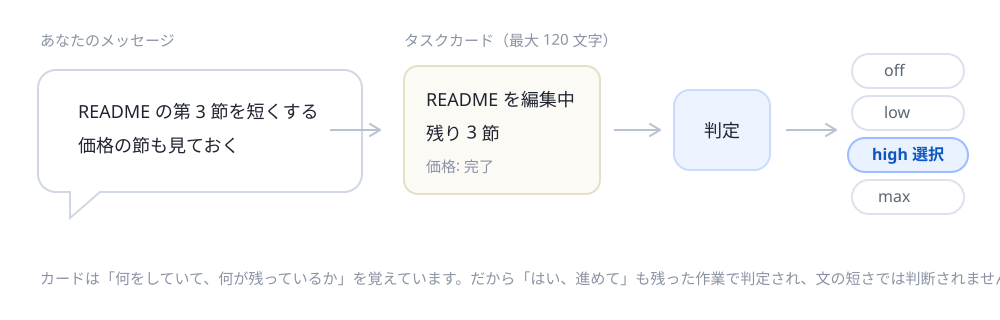
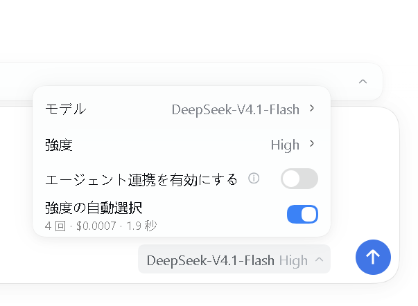

## 3つの数字

- 1メッセージあたり、オフピークで約 **`$0.0002`**、ピーク時で約 **`$0.0004`** の追加費用。
- 1メッセージあたり約 **0.7 秒**の追加の待ち時間。
- 操作は不要：インストールした瞬間から動きます。

## オンとオフ

- 既定でオン。
- 強度を手動で選ぶと、**この会話**ではオフになります。
- プラグインのページでプラグインをオフにすると、**すべての会話**で止まります。

## 4つの強度の使い分け

| 強度 | 用途 |
|---|---|
| `off` | 雑談、確認、調べもの、設定の変更、コマンド実行 |
| `low` | 小さな修正、名前の変更、整理、既存のパターンの適用 |
| `high` | 分析、デバッグ、理由の説明、それなりの規模のコード |
| `max` | アーキテクチャ、選択肢の比較、多要素のトレードオフ、厄介なバグ |

## やらないこと

- 設定を変更したり、設定ファイルを書き換えたりしません。
- サブエージェントは対象外です。

## 止まるとき

判定が3回連続で失敗した場合、またはターンが API エラーになった場合、プラグインはその会話を一時停止し、入力欄の上に出るバーに理由が表示されます。バーの**もう一度オンにする**を押すか、スイッチをオフにしてからもう一度オンにすれば復帰します。
