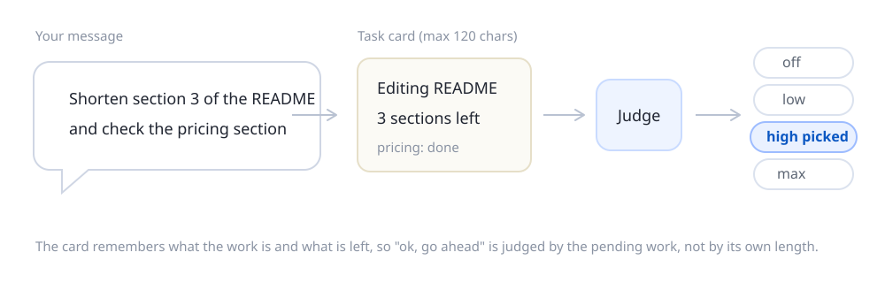
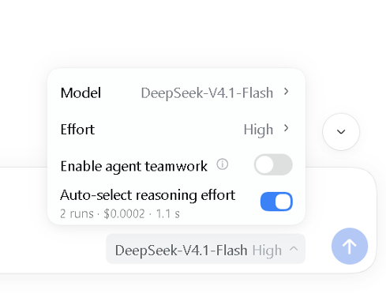

## Three numbers

- About **`$0.0002`** extra per message in off-peak hours, about **`$0.0004`** at peak.
- About **0.7 s** of extra waiting per message.
- Nothing to do: it starts working the moment it is installed.

## Turning it on and off

- On by default.
- Picking any effort by hand turns it off **for this conversation**.
- Turning the plugin off on the plugin page stops it **in every conversation**.

## What the four efforts are for

| Effort | What it is for |
|---|---|
| `off` | chat, confirmations, lookups, config edits, running commands |
| `low` | small edits, renames, tidying, applying a known pattern |
| `high` | analysis, debugging, explaining why, non-trivial code |
| `max` | architecture, comparing options, multi-factor tradeoffs, hard bugs |

## What it does not do

- It does not change your settings or rewrite your config.
- It ignores subagents.

## When it stops

If judging fails three times in a row, or a turn hits an API error, the plugin pauses that conversation and a bar above the input box tells you why. Press **Turn it back on** in the bar, or toggle the switch off and on again.
