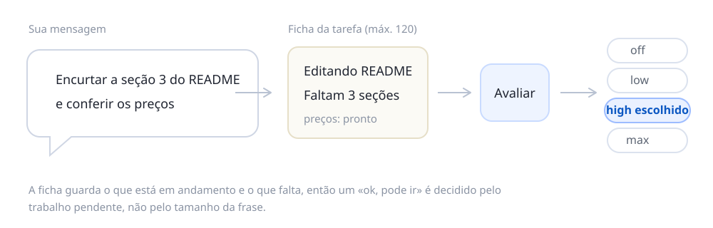
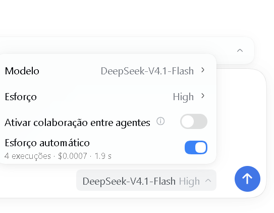

## Três números

- Cerca de **`$0.0002`** extra por mensagem fora do horário de pico e cerca de **`$0.0004`** no pico.
- Cerca de **0,7 s** de espera extra por mensagem.
- Nada a fazer: começa a funcionar no momento em que é instalado.

## Ligar e desligar

- Ligado por padrão.
- Escolher qualquer esforço à mão o desliga **nesta conversa**.
- Desligar o plug-in na página do plug-in o interrompe **em todas as conversas**.

## Para que servem os quatro esforços

| Esforço | Para que serve |
|---|---|
| `off` | conversa, confirmações, consultas, edição de configuração, execução de comandos |
| `low` | pequenas edições, renomeações, organização, aplicação de um padrão conhecido |
| `high` | análise, depuração, explicar o porquê, código não trivial |
| `max` | arquitetura, comparação de opções, trade-offs de vários fatores, bugs difíceis |

## O que ele não faz

- Ele não altera suas configurações nem reescreve sua configuração.
- Ele ignora os subagentes.

## Quando ele para

Se a avaliação falhar três vezes seguidas, ou um turno der erro de API, o plug-in pausa essa conversa e uma barra acima da caixa de entrada explica o porquê. Pressione **Ativar novamente** na barra, ou desligue e ligue o interruptor de novo.
