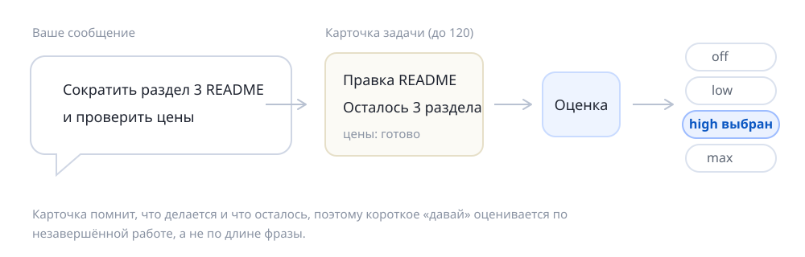
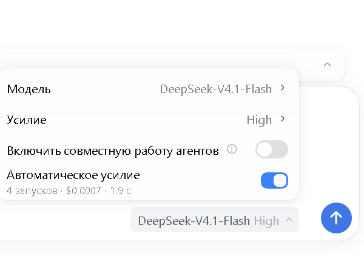

## Три цифры

- Около **`$0.0002`** дополнительно за сообщение в непиковые часы, около **`$0.0004`** в пиковые.
- Около **0,7 с** дополнительного ожидания на сообщение.
- Ничего делать не нужно: плагин начинает работать в момент установки.

## Включение и выключение

- Включён по умолчанию.
- Ручной выбор любого усилия отключает его **в этой беседе**.
- Отключение плагина на странице плагина останавливает его **во всех беседах**.

## Для чего нужны четыре усилия

| Усилие | Для чего |
|---|---|
| `off` | беседа, подтверждения, поиск информации, правка конфигурации, выполнение команд |
| `low` | небольшие правки, переименования, уборка, применение известного шаблона |
| `high` | анализ, отладка, объяснение причин, нетривиальный код |
| `max` | архитектура, сравнение вариантов, многокритериальные компромиссы, сложные баги |

## Чего он не делает

- Он не меняет ваши настройки и не переписывает конфигурацию.
- Он игнорирует субагентов.

## Когда он останавливается

Если оценка три раза подряд завершается неудачей или ход упирается в ошибку API, плагин приостанавливает эту беседу, а над полем ввода появляется полоса с причиной. Нажмите в ней **Включить снова** или выключите и снова включите переключатель.
