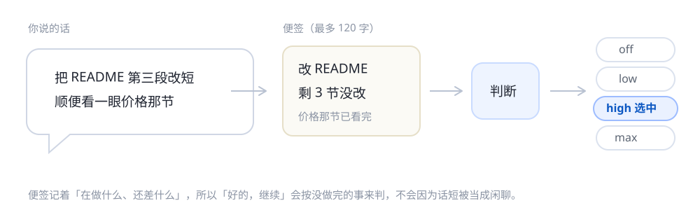

## 三个数字

- 每条消息多花约 **¥0.0013**（繁忙时段约 ¥0.0027）。
- 每条消息多等约 **0.7 秒**。
- 不用你操作：装好就在运行。

## 开启与关闭

- 默认开着。
- 手动选任意一个推理等级：关掉**这个对话**的自动。
- 在插件页把插件关掉：**所有对话**都停。

## 四档分别用在哪

| 等级 | 用在哪 |
|---|---|
| `off` | 闲聊、确认、查资料、改配置、跑命令 |
| `low` | 小改动、改名、整理、照着已有写法改 |
| `high` | 分析原因、排查报错、解释原理、写较复杂的代码 |
| `max` | 架构方案、多方案比较、多因素权衡、疑难 bug 根因 |

## 它不做什么

- 不改你的设置，不写配置文件。
- 子会话（subagent）不管。

## 什么时候会停

判断连续失败 3 次，或者某一轮 API 报错，插件会暂停这个对话，并在输入框上方出现一条提示条，写明原因。点提示条上的**重新打开**，或者把菜单里的开关关一下再打开，就会恢复。
